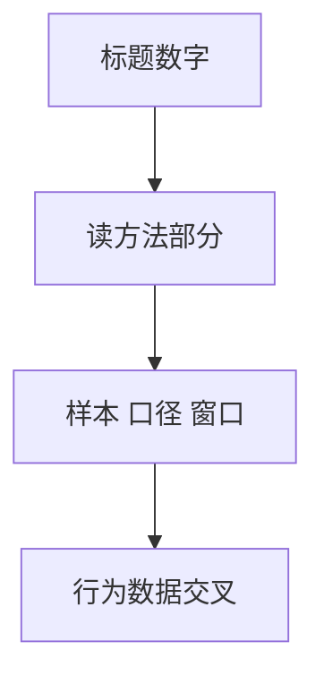

## Q
**读一份企业调查**｜怎么读 · 追问

一份报告写「95% 的企业 AI 试点没有产生回报」（假设的标题）。你要从方法部分找到哪些信息，才能决定相信几分？

## A
| 问题 | 为什么 |
|---|---|
| 样本多大、怎么选的 | 自愿问卷、访谈几十人、随机抽样的可信度完全不同 |
| 受访者是谁 | 高管自评与一线使用者的说法不同 |
| 「回报」怎么定义 | 财务回报、效率提升、还是主观满意 |
| 时间窗口 | 试点只跑了几个月时，看不到回报 |
| 谁出的钱 | 咨询、厂商、媒体的立场不同 |
| 有没有对照 | 与不采用 AI 的组织比较 |

**三步判断：** ① 把标题数字改写成一个具体的问题；② 看这个问题能不能被样本回答；③ 找一个行为数据（用量、招聘、收入）去交叉验证。

出处

通用调查方法；示例标题为虚构。

