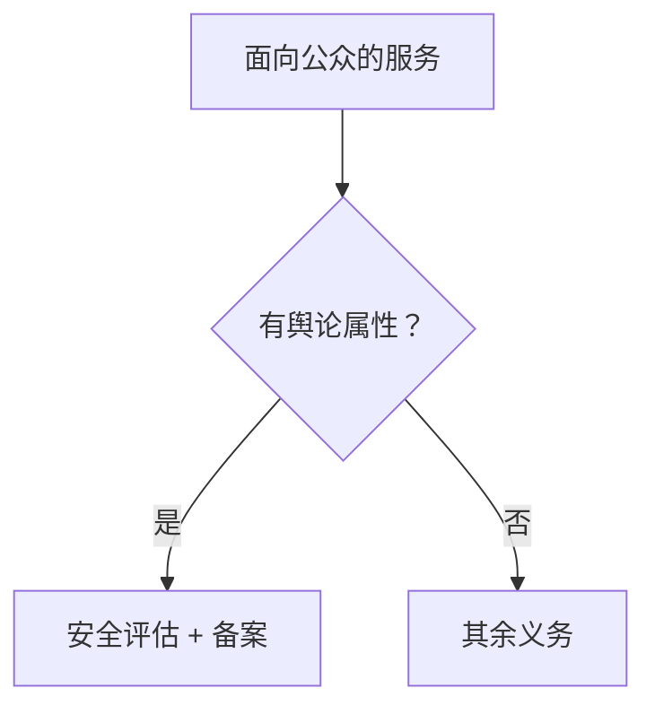

## Q
**中国的应用与监管环境**｜摘要 · 追问

在中国做一个面向公众的生成式 AI 应用，要先满足哪些条件？

## A
**依据：** 《生成式人工智能服务管理暂行办法》，2023-08-15 生效，网信办（CAC）联合六个部门发布。

| 项 | 内容 |
|---|---|
| 适用 | 向中国境内公众提供生成式 AI 服务的提供者；企业仅内部使用的不在其内 |
| 备案与评估 | 服务有「舆论属性」或「社会动员能力」的（论坛、社交、博客、聊天室类），要做安全评估和算法备案 |
| 数据 | 训练数据处理要合法 |
| 用户 | 订立服务协议；设投诉渠道；核验年龄，保护未成年人 |
| 内容 | 遵守深度合成标识规则；发现违法内容要及时报告 |

**对产业的含义：** 合规是上线的前置步骤，增加了进入成本，也使本地提供者有天然的先发优势。不是法律意见。

**出处：** DLA Piper, China new measures on generative AI（2023-07）。
