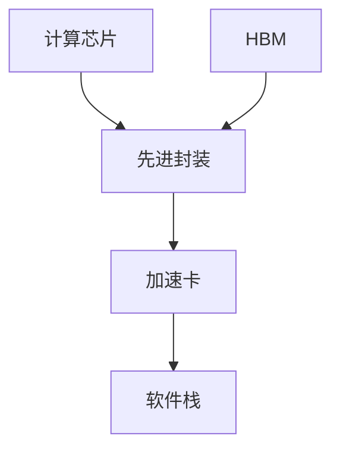

## Q
**国产芯片的三个检查点**｜怎么读 · 追问

新闻说「某国产 AI 芯片性能追平 NVIDIA 某型号」。你怎么判断它能不能真的撑起前沿训练？

## A
**一块能用的 AI 加速卡要三样东西，缺一不可：**

| 环节 | 问题 |
|---|---|
| 制程与 foundry | 计算芯片用什么工艺、谁制造、良率与产能如何 |
| HBM | 显存从哪来；带宽与容量是否够跑大模型（见 HBM 一卡：全球 HBM 只有三家供应商） |
| 先进封装 | 能否把计算芯片与 HBM 封在一起（见 CoWoS 一卡） |
| 软件栈 | 编译器、算子库与框架适配程度（见 CUDA 一卡） |

**读新闻的做法：** 先看峰值参数还是**实测训练或推理吞吐**；再看**出货量**与**客户在生产环境的使用**。参数追平而出货和生态没跟上，不等于能替代。

出处

通用供应链分析；TrendForce News 2026-08-10（HBM 供应格局）。本卡不含具体型号数据。

