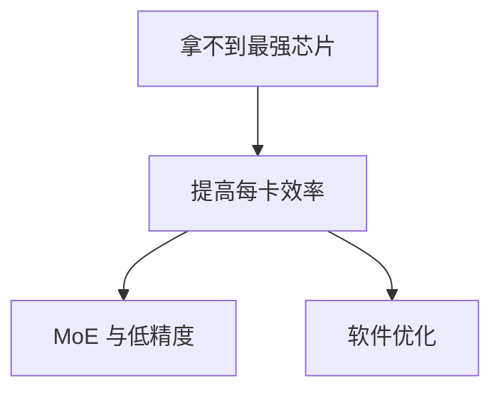

## Q
**算力受限下的工程取舍**｜摘要 · 必会

出口管制让中国公司拿不到最强的芯片。他们在软件和模型设计上有哪几类取舍？为什么说这让成本曲线更陡？

## A
**受限的事实：** NVIDIA 2026 财年有 45 亿美元与 H20 库存和采购承诺相关的费用；2027 财年第一季度指引不假设来自中国的 data center compute 收入（NVIDIA 财报）。BIS 2026-01 的规则允许符合条件的逐案许可，数量不超过美国国内出货的 50%。

**取舍：**

| 方向 | 做法 | 代价 |
|---|---|---|
| 模型结构 | **MoE**（mixture of experts：每个 token 只激活部分参数，总参数大但每次计算少） | 实现更复杂，路由要平衡 |
| 精度 | 低精度计算（用更少位数存数字） | 数值稳定性要调 |
| 软件 | 在同一块芯片上榨出更高利用率 | 工程人力 |
| 芯片 | 用国产加速器，要重做软件栈 | 迁移成本，生态不成熟 |

**为什么曲线更陡：** 硬件拿不到时，每一分效率提升都直接变成可训练的规模；所以会出现「用更少的卡达到相近分数」的论文和产品。

**核对日期：** 2026-11-21。

**出处：** NVIDIA FY2026 10-K MD&A、Q4 FY2026 新闻稿；Federal Register 2026-01-15（BIS）；MoE 定义为通用知识。
