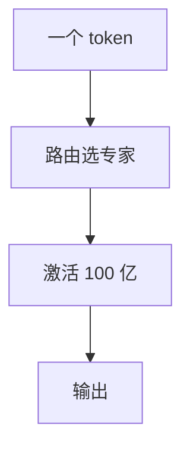

## Q
**MoE 的账**｜考点 · 追问

一个 MoE 模型总参数 600 亿，每个 token 激活 100 亿。比同样 600 亿参数的 dense 模型（每次用全部参数）训练或推理节省多少计算？显存需求呢？

## A
**演算（假设数字）：**
- 每个 token 的计算量正比于激活的参数：10 ÷ 60 ≈ 1/6，约节省 83% 的计算。
- 显存：所有参数都要放进内存（路由随时可能用到任一专家）：仍要放下 600 亿个参数，**没有节省**。

| | Dense 600 亿 | MoE 600 亿（激活 100 亿） |
|---|---|---|
| 每 token 计算 | 全部 600 亿 | 约 100 亿 |
| 参数存储 | 600 亿 | 600 亿 |
| 瓶颈 | 算力 | 存储与专家之间的通信 |

**含义：** MoE 用存储换计算：算力受限时划算，但显存与 HBM（高带宽显存，见前面）反而更重要。

出处

通用 MoE 机制；数字为演示用。

