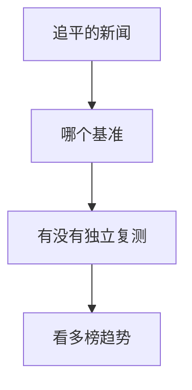

## Q
**「中国追平了」怎么读**｜怎么读 · 追问

一条新闻说「中国模型在榜单上追平美国」。你怎么确认它说的是实质性的追平，而不只是某个基准的巧合？

## A
| 检查 | 方法 |
|---|---|
| 哪个榜、哪个子项 | 单项还是综合；基准是否已饱和（分数接近上限，差距自然缩小） |
| 比较对象 | 对的是美国当时的最强，还是上一代 |
| 开放权重还是 API | 开放模型能被独立复现与评测；API 模型只能看公司给的结果 |
| 第三方复测 | 独立机构有没有复现 |
| 价格与成本 | 同样分数的价格差；成本曲线能说明工程效率 |

**更稳的做法：** 多个独立榜单（能力基准、人类偏好榜、真实任务评测）里的相对位置，随时间的变化趋势，比某一天的名次可靠。

出处

Stanford HAI, AI Index Report 2025（基准接近持平）；通用评测读法。

