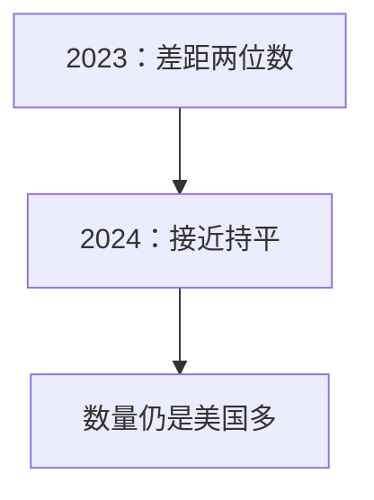

## Q
**中美模型差距**｜摘要 · 必会

中国模型公司与美国前沿的差距现在有多大？用哪些数据说，哪些说法要保留？

## A
**数据（Stanford AI Index 2025，2024 年）：**

| 指标 | 数字 |
|---|---|
| 2024 年新发布的 notable AI models（有影响力的模型） | 美国 40 个，中国 15 个，欧洲 3 个 |
| MMLU、HumanEval 上中美模型的差距 | 从 2023 年的两位数缩到 2024 年接近持平 |

**这两个数的口径：** notable models 是 Epoch AI 按影响力标准挑选的；MMLU 是多学科知识测验、HumanEval 是代码题基准，都是**部分基准**，不是全面比较。

**State of AI 2026：** 上年预测「中国公司会在重要的任务榜单上登顶」被评为命中；开放权重路线是中国公司的主要打法（见后面的价格战与开放策略）。

**两个陷阱：** ① 基准持平不等于生产环境持平；② 模型数量多不等于前沿领先。

**核对日期：** 2026-11-21。

出处

Stanford HAI, AI Index Report 2025；State of AI Report 2026（stateof.ai）。

