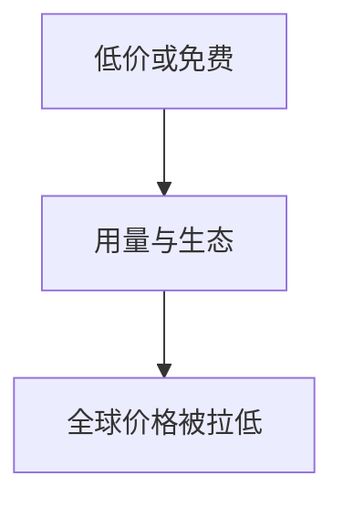

## Q
**Price war 与开放策略**｜摘要 · 追问

中国模型公司为什么愿意打价格战、免费开放权重？它能带来海外采用吗？

## A
| 动机 | 逻辑 |
|---|---|
| 抢开发者和用量 | 在能力接近时，低价是最快的获客方式 |
| 生态与影响力 | 开放权重被全球开发者下载、微调，成为事实标准 |
| 主业补贴 | 云、广告、硬件等业务赚钱，模型是引流 |
| 算力约束下的效率 | 受限的硬件迫使团队把成本压低，低成本再变成定价优势 |

**对全球价格的影响：** 开放权重可被任何云托管，同能力价格被拉向硬件成本；AI Index 2025 显示开放与闭源的基准差距在部分基准上缩到 1.7%。

**海外采用的限制：** 数据与合规顾虑；企业对供应商来源的审查；不同地区的监管差异（见监管卡）。

**怎么读「价格战」：** 看谁在降价、降的是列表价还是成交价；价格低是靠效率还是靠补贴；毛利与现金流。

出处

Stanford HAI, AI Index Report 2025；本卡无新增数字。

