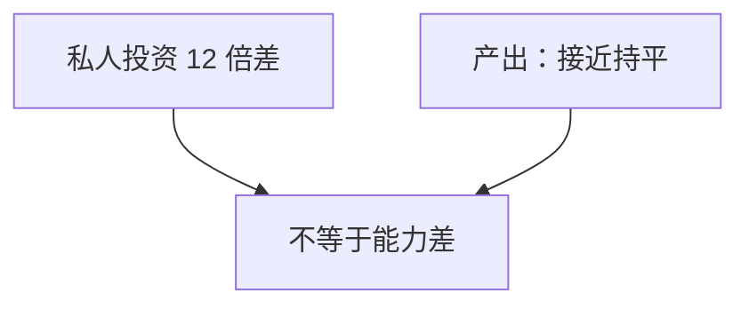

## Q
**中美投资规模对比**｜摘要 · 追问

2024 年美国私人 AI 投资是中国的近 12 倍。这个数字应该怎么用，为什么不能直接说「中国落后 12 倍」？

## A
**数据（Stanford AI Index 2025，2024 年）：** 美国私人 AI 投资 1091 亿美元，中国 93 亿美元，英国 45 亿美元。

| 口径问题 | 说明 |
|---|---|
| 只含**私人**投资 | 政府与国有资本的出资不在内 |
| 投资 ≠ 产出 | 同期美国 40 个 notable models，中国 15 个；主要基准上两国模型接近持平 |
| 资本结构不同 | 美国靠风险投资与大公司现金流；中国有政府引导基金与大公司资本，口径难以对齐 |
| 币种与计价 | 按名义美元 |

**判断：** 这个比值能说明**私人资本市场的规模差**；要判断创新能力，要搭配产出指标（模型、论文、基准、成本）。

**核对日期：** 2026-11-21。

**出处：** Stanford HAI, AI Index Report 2025。
