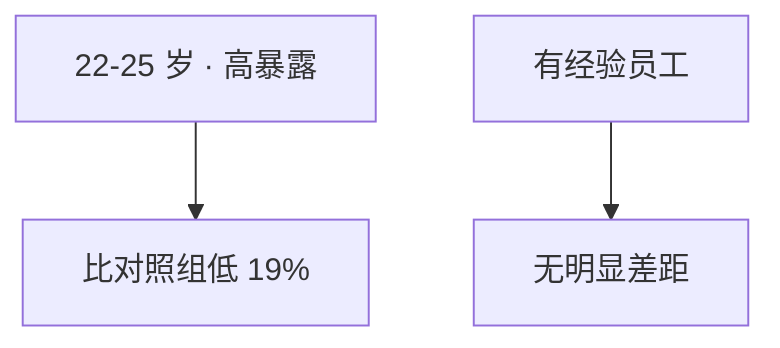

## Q
**Entry-level 岗位的证据**｜摘要 · 必会

「AI 让年轻人找不到工作」有数据支持吗？Brynjolfsson 等人的研究说了什么，又没说什么？

## A
**研究：** Canaries in the Coal Mine?（Brynjolfsson、Chandar、Chen，2026-08 修订）。数据来自 ADP 的工资单行政数据，覆盖数百万美国劳动者，截至 2026 年 6 月。

| 说了 | 内容 |
|---|---|
| 22–25 岁人群 | 在 AI 暴露度高的职业里，就业比「与暴露度低的同龄人保持同步」的情况低 19% |
| 有经验的员工 | 没有类似的差距 |
| 机制 | 主要是少招年轻人，而不是裁人 |
| 方向 | AI 主要替代任务的职业下降；AI 主要辅助任务的职业持平或上升 |

| 没说 | 内容 |
|---|---|
| 全经济范围的失业 | 作者没有发现普遍性的岗位流失 |
| 因果 | 作者称结果是早期的描述性指标，而非因果估计；控制教育后差距会变小 |

出处

Brynjolfsson, Chandar, Chen, Canaries in the Coal Mine?（digitaleconomy.stanford.edu/publications/canaries-in-the-coal-mine，2026-08 修订）。

