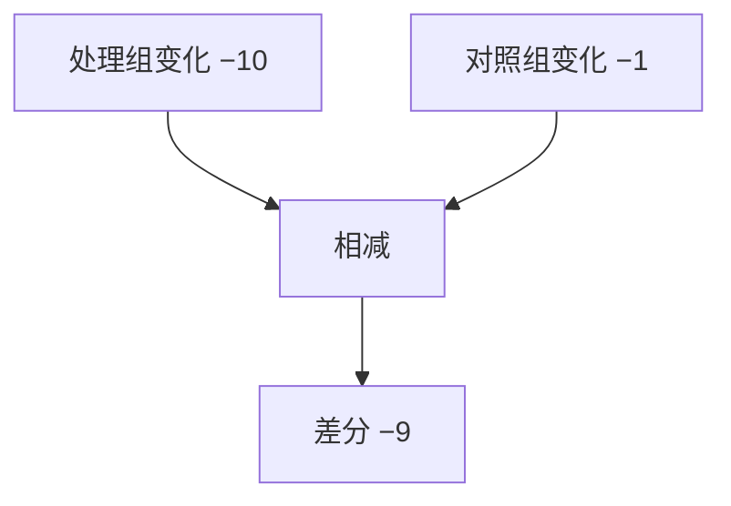

## Q
**差分比较与因果**｜考点 · 追问

研究说高暴露职业的年轻人就业「比对照组低 19%」。用一个玩具例子说明「差分比较」在算什么，以及它在什么情况下会误判？

## A
**差分比较（difference-in-differences）：** 比较「处理组」和「对照组」在事件前后的**变化之差**，而不是比较水平。

**玩具例子（假设数字）：**

| | 事件前就业指数 | 事件后 | 变化 |
|---|---|---|---|
| 高暴露（处理） | 100 | 90 | −10 |
| 低暴露（对照） | 100 | 99 | −1 |

差分 = −10 − (−1) = −9：扣掉了「大家都受影响」的共同趋势（如利率、经济周期）。

**什么时候误判：** 事件前两组就已经在分开走（预趋势）；同期还有别的冲击只打在高暴露组（如某类岗位对利率更敏感）；研究者自己也承认部分分歧在生成式 AI 之前就有，且控制教育后差距缩小。

**出处：** Canaries in the Coal Mine?（Brynjolfsson 等，2026-08）关于局限的说明；差分方法为通用计量经济学。
