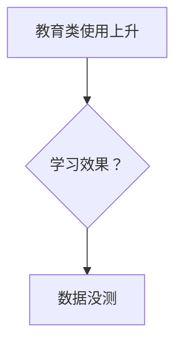

## Q
**教育与新人路径**｜摘要 · 追问

学生和新人怎么使用 AI？现有证据能支持怎样的结论？

## A
**使用数据（Anthropic Economic Index，2026-01，2025 年 11 月）：** 教育类任务（educational instruction）是 Claude.ai 上第二大类别，占比从 2025 年 1 月的 9% 升到 11 月的 15%。API 上教育类只占 4%，Claude.ai 为 16%（该报告另一处口径）。国家层面：课程作业类使用在较低收入国家占比更高；工作与个人使用在较高收入国家更高。

**能说的：** 学习是 AI 的主要用途之一，且在上升。

**不能说的：**
- 用得多不等于学得好：数据只记录使用，不测学习效果；
- 新人路径的变化：Canaries 研究显示的是入门**招聘**减少，不是学习方式的变化；
- 每个数字来自一家公司的用户。

**证据有限处明说：** 本领域对学习效果的对照研究仍少，下结论前要找随机或对照设计。

**核对日期：** 2026-11-21。

出处

Anthropic Economic Index: Economic Primitives（2026-01）；Canaries in the Coal Mine?（2026-08）。

