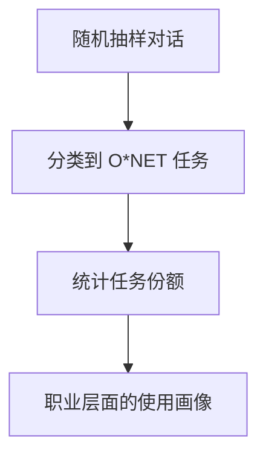

## Q
**Job exposure 怎么测**｜摘要 · 必会

「某个职业有多少比例会被 AI 取代」这种数字是怎么算出来的？Anthropic Economic Index 用的是哪一种方法？

## A
**核心思路：任务拆解（task decomposition）。** 一个职业不是一个整体，而是一组任务；**O\*NET**（美国劳工部的职业信息数据库）给每个职业列出了任务清单。

| 方法 | 做法 | 问题 |
|---|---|---|
| 理论暴露度 | 专家或模型判断每个任务「能否被 AI 做」 | 能做不等于会做 |
| 使用数据 | 看真实对话或 API 调用里 AI 实际做了哪些任务 | 只覆盖该产品的用户 |

**Anthropic Economic Index（2026-01，样本 2025-11-13 至 11-20）：** 随机抽取 100 万条 Claude.ai 对话和 100 万条第一方 API 记录，由 Claude 做分类，把每条记录映射到 O\*NET 任务；少于 15 个对话且少于 5 个独立账号的格子被过滤。报告自己称这些结果是「方向上准确，而非精确」。

**局限：** 是一家公司的产品用户，不代表全经济；使用不等于生产率或岗位变化。

**核对日期：** 2026-11-21。

出处

Anthropic Economic Index: Economic Primitives（anthropic.com/research/anthropic-economic-index-january-2026-report）。

