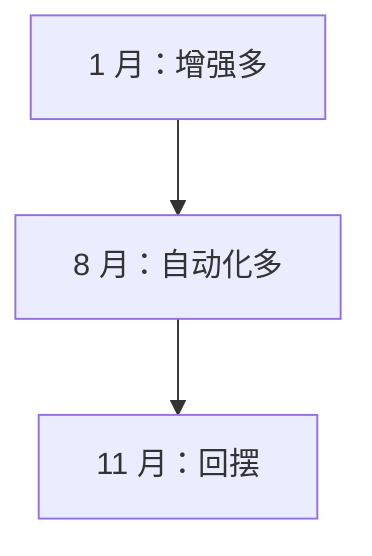

## Q
**自动化与增强的摆动**｜考点 · 追问

Anthropic 的数据里，自动化（automation）和增强（augmentation）的占比一直在变。一个数据点能支持「AI 正在取代人」吗？

## A
**定义：** **Automation**：用户给任务，AI 基本独立完成（directive 就是其中最直接的一种）；**Augmentation**：用户与 AI 来回协作、AI 辅助人。

**Claude.ai 的数据（Anthropic Economic Index，2026-01）：**

| 时间 | 增强 | 自动化 |
|---|---|---|
| 2025 年 1 月 | 56% | 41% |
| 2025 年 8 月 | 自动化超过增强 | |
| 2025 年 11 月 | 52% | 45% |

Directive 对话占比：27%（1 月）→ 39%（8 月）→ 32%（11 月）。API 上约四分之三是自动化。

**判断：** 摆动说明这个比例**不是单向趋势**；一个时点不能支持任何强结论。同样的数字也受产品改版、用户构成变化影响。

出处

Anthropic Economic Index: Economic Primitives（2026-01）。

