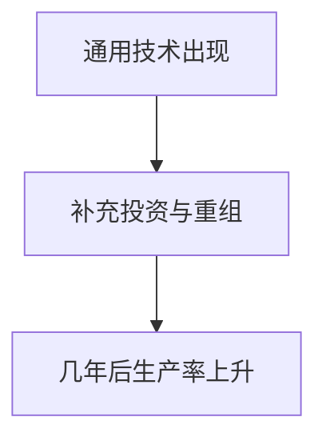

## Q
**为什么生产率统计里还看不见**｜摘要 · 追问

AI 用得这么广，为什么宏观生产率数据还没明显变化？历史上有过类似的滞后吗？

## A
**历史类比：** 电力与计算机都经历过长期滞后。1987 年经济学家 Solow 说「计算机时代随处可见，唯独生产率统计里看不到」。

**四个原因：**

| 原因 | 说明 |
|---|---|
| 扩散慢 | 通用技术需要补充投资：重组流程、培训、改工作方式 |
| 采用深度浅 | 「用了 AI」的门槛低（AI Index 2025：78% 的组织报告在用，2024 年），不等于深度改造 |
| 统计口径 | 免费或低价的服务，价格统计里不反映质量提升 |
| 分母分子 | 时间节省若被用在别处，总产出才会变 |

**怎么看：** 看**企业层面**的微观研究与**任务层面**的使用数据（如 Anthropic 估计的任务节省时间），比宏观数字更早出现信号。

**出处：** Stanford HAI, AI Index Report 2025（78% 采用）；Solow 的评语为经济史常识。
