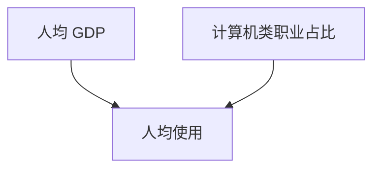

## Q
**地区与行业差异**｜摘要 · 追问

AI 的采用在不同国家和美国各州是否均匀？用什么数据说，结论有多强？

## A
**数据（Anthropic Economic Index，2026-01）：**

| 指标 | 数字 |
|---|---|
| 国家层面：人均 GDP 每高 1%，人均使用高 | 0.7% |
| 美国各州：前五个州的使用占比 vs 劳动年龄人口占比 | 50% vs 38% |
| 美国州内集中度（Gini） | 从 0.37 降到 0.32 |
| 各州 computer 与 mathematical 工人占比每高 1%，人均使用高 | 0.36% |
| 美国各州「追平」所需时间的估计 | 2–5 年（作者自己说只基于三个月的数据，不确定性很大） |

**使用最多的国家：** 美国、印度、日本、英国、韩国。

**读法：** 使用强度与收入、职业结构强相关；这是**相关**，不是因果；「追平」是外推。

**核对日期：** 2026-11-21。

出处

Anthropic Economic Index: Economic Primitives（2026-01）。

