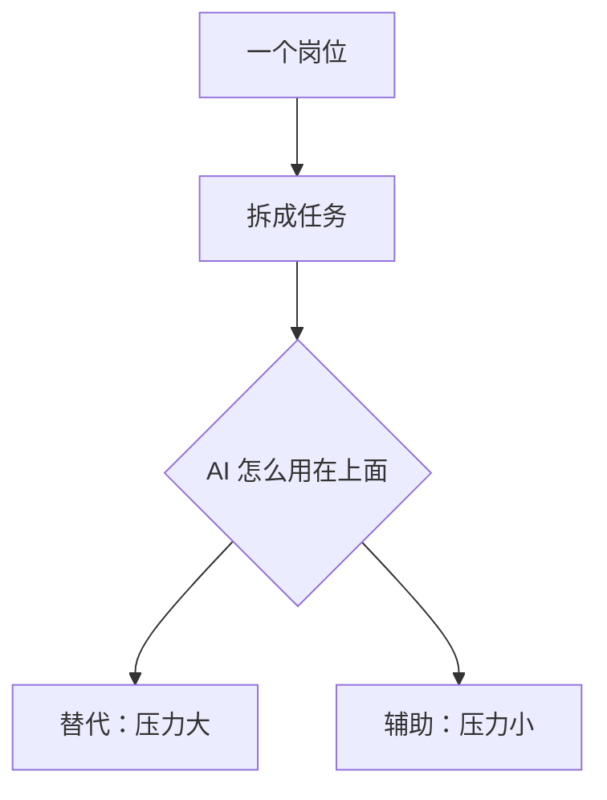

## Q
**哪些岗位增长、哪些收缩**｜摘要 · 必会

「哪些岗位会增长，哪些会收缩」的清单满天飞。你用什么框架判断一个岗位族，证据又该从哪里来？

## A
**不按职业名，按任务：**

| 类型 | 判断 | 证据（已有的） |
|---|---|---|
| 替代型（substitute） | AI 的使用主要是直接把任务做完 | Canaries：此类职业的年轻员工就业下降 |
| 辅助型（complement） | AI 使用主要在辅助人，人的判断仍是核心 | Canaries：此类职业就业持平或上升，尤其有经验的员工 |
| 新增需求 | 需要建设与保障 AI 的岗位（数据中心、电力、评测、安全） | 要看招聘数据与建设项目，例如 State of AI 2026 提到的数据中心扩建 |

**读清单的方法：** 问每个结论是来自**真实就业数据**、**使用数据**、还是**专家判断**；前两种可核对，后一种是意见。

**诚实的边界：** 现有证据多是描述性的，且集中在美国；哪个具体岗位会收缩，今天没有可靠的清单。

**出处：** Canaries in the Coal Mine?（2026-08）；Anthropic Economic Index（2026-01）。
