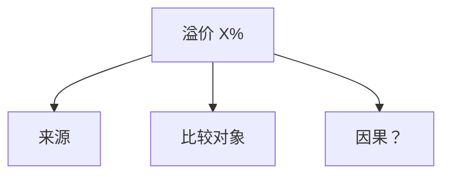

## Q
**「AI 技能溢价」怎么读**｜怎么读 · 追问

一份报告说「有 AI 技能的岗位薪酬高出 X%」。要问什么才知道能不能信？

## A
| 问题 | 为什么 |
|---|---|
| 数据来源 | 招聘广告标价、雇主申报、还是问卷自报；广告标价不是成交薪酬 |
| 比较对象 | 同职位同级别比，还是整体平均比（AI 岗位本身偏资深，会放大差距） |
| 「AI 技能」的定义 | 写在广告里的关键词，还是实际工作内容 |
| 因果 | 技能带来溢价，还是公司愿意给高薪的人本来就会学 AI |
| 谁出的报告 | 招聘平台、培训机构、咨询公司的立场 |

**可靠度排序：** 行政数据（薪资单、税务）> 招聘广告大样本 > 问卷自报 > 厂商报告。

**出处：** 通用实证研究读法；本卡不含数字。
