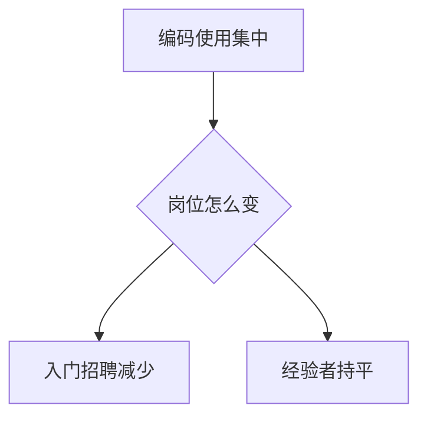

## Q
**软件工程岗位的证据**｜摘要 · 必会

软件工程是 AI 用得最多的领域。哪些数据支撑这一点，对「岗位怎么变」又能说明什么？

## A
**使用数据（Anthropic Economic Index，2026-01，2025 年 11 月样本）：**

| 指标 | Claude.ai | API |
|---|---|---|
| computer 与 mathematical 类任务占比 | 34%（2025 年 3 月峰值 40%） | 46%（8 月为 44%） |
| 最常见的单个任务 | 修改软件以纠正错误，占 6% | 约十分之一的记录 |

**能说什么：** 编码是 AI 使用最集中的任务类型；任务级数据显示 AI 在调试、改代码上用得多。

**不能说什么：**
- 使用多不等于岗位少：Canaries 研究里受影响的是**年轻**员工的招聘，有经验者没有类似差距；
- 数据来自一家公司的产品。

**对你的含义：** 层级结构的压力更可能落在入门岗位（招聘减少），经验与判断的价值相对上升。这只是外推，要用招聘数据持续验证。

**核对日期：** 2026-11-21。

出处

Anthropic Economic Index: Economic Primitives（2026-01）；Canaries in the Coal Mine?（2026-08）。

