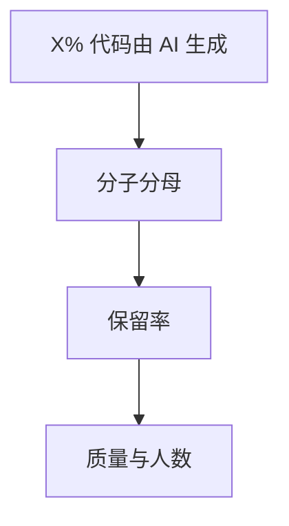

## Q
**「AI 写了 X% 的代码」怎么读**｜怎么读 · 追问

一家公司说「我们 X% 的新代码由 AI 生成」。要问哪几件事，才能把它和「工程师需求减少」区分开？

## A
| 问题 | 为什么 |
|---|---|
| 分子分母是什么 | 按行数、按提交、还是按接受的建议；补全一行算不算 |
| 生成后有多少被保留 | 生成了但被删掉的不算有效产出 |
| 质量与返工 | 缺陷率、评审时间有没有变化 |
| 同期需求有没有变 | 代码总量增加时，人数可以不减 |
| 谁在报告 | 厂商宣传与独立研究的立场不同 |

**判断：** 要的是**产出与结果**的指标（交付速度、缺陷、人力），而不是产生量。

**出处：** 通用度量方法；Anthropic Economic Index（2026-01）的使用数据口径说明。
