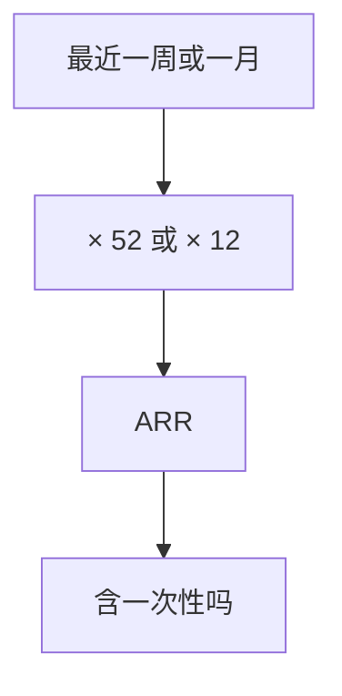

## Q
**ARR 的口径**｜怎么读 · 必会

「年化收入 10 亿美元」可以由哪几种算法得到？为什么不同公司的 ARR 不能直接比？

## A
**ARR（annualized revenue，年化收入）** 没有统一标准，常见几种算法：

| 算法 | 公式 | 偏差 |
|---|---|---|
| 月收入外推 | 最近一个月 × 12 | 季节性或一次性高峰会放大 |
| 周收入外推 | 最近一周 × 52 | 波动更大 |
| 合同口径 | 已签约的年度经常性合同金额 | 未上线、可取消的合同会虚高 |
| 用量口径 | 当期用量 × 当期单价 × 12 | 单价下降时会过时 |

**要区分：**
- **可重复（recurring）收入**：订阅、持续用量。**一次性收入**：项目费、培训、一次性许可。
- **烧钱率（burn rate）**：每月净现金流出；ARR 高而烧钱更快，不是好消息。

**比较前：** 问口径、问时间点、问有没有拆出一次性收入。

**出处：** 通用 SaaS 指标定义。
