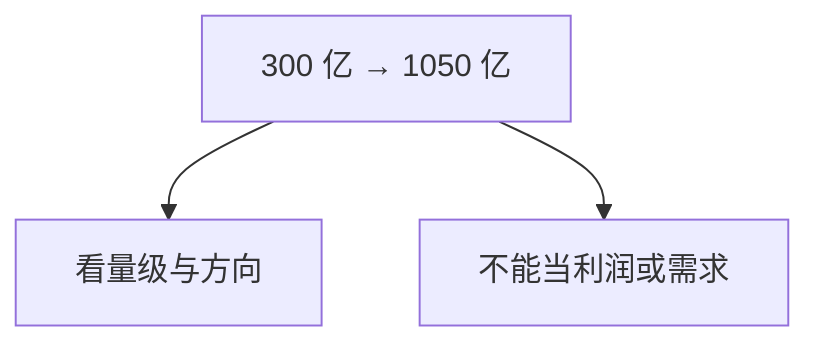

## Q
**融资新闻里的收入数**｜怎么读 · 追问

State of AI 2026 说 OpenAI 与 Anthropic 合计年化收入从年初约 300 亿美元升到夏末约 1050 亿美元。你要怎么用这个数，哪些话不能由它推出？

## A
**怎么用：** 当作**量级和方向**：两家合计增长约 3.5 倍（1050 ÷ 300），说明这一层的收入在快速增长。

**不能推出：**

| 想说的 | 为什么不行 |
|---|---|
| 「两家各赚了多少」 | 数字是合计，且是年化口径，不是已收的钱 |
| 「已经盈利」 | 年化收入不含成本；要看毛利和现金流 |
| 「全行业需求」 | 不含其他 lab 和应用公司；也含对云的转售 |
| 「会持续」 | 外推窗口只有半年 |

**追问：** 原文里这个数的出处是什么（公司表态还是媒体估计）？口径是月×12 还是合同？

**核对日期：** 2026-11-21。

**出处：** State of AI Report 2026（stateof.ai）。
