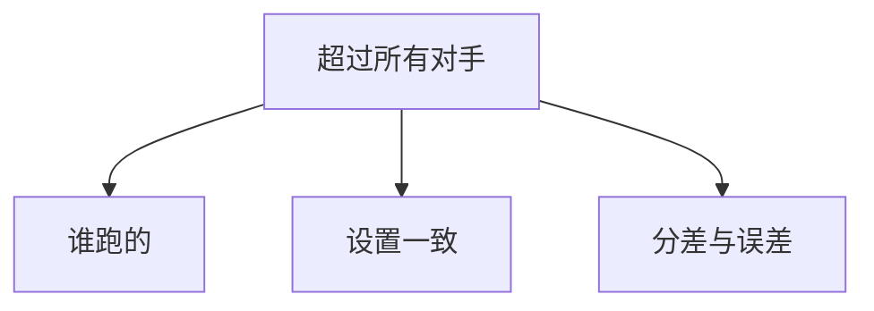

## Q
**一条 benchmark 声明的核对清单**｜怎么读 · 必会

厂商博客写「我们的新模型在 X 基准上超过所有对手」。给出你会逐条追问的五件事。

## A
| # | 追问 | 看什么 |
|---|---|---|
| 1 | 谁跑的？ | 自己跑 vs 第三方独立复现 |
| 2 | 设置一样吗？ | 提示、工具、重试次数、思考预算，对手是否用了同样的设置 |
| 3 | 对手选得全吗？ | 有没有省掉更强的对手，或只拿旧版本比 |
| 4 | 分差多大？ | 与测量误差相比（题少的基准，1–2 分是噪声） |
| 5 | 基准还有区分度吗？ | 是否已饱和，是否可能污染 |

**判断：** 一条声明至少要有 1（独立复现）和 2（同设置）才算可信；其余用于估计它的重要性。

**出处：** State of AI Report 2026（工具与设置影响成绩的例子）；通用评测读法。
