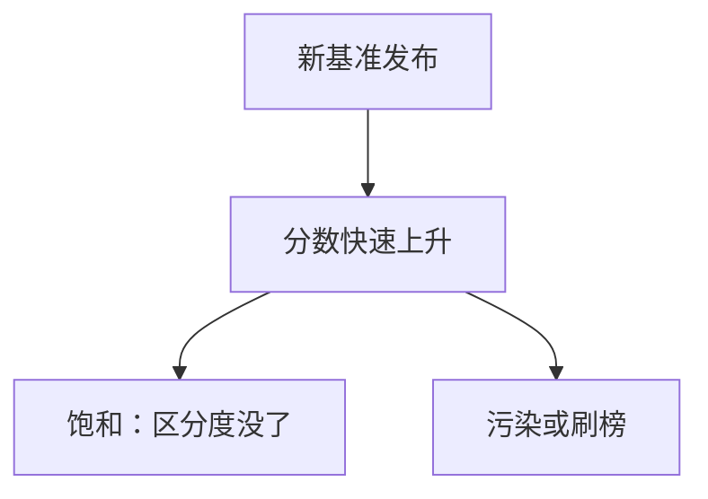

## Q
**Benchmark 的三个坑**｜怎么读 · 必会

一个新基准发布时模型只能拿 20 分，几个月后榜首 90 分。这条曲线能说明什么？saturation、contamination、gaming 各是什么？

## A
| 坑 | 定义 | 信号 |
|---|---|---|
| **Saturation（饱和）** | 分数接近上限，榜单不再区分模型 | 前几名分差在误差范围内 |
| **Contamination（污染）** | 测试题或答案出现在训练数据里，模型是「背」出来的 | 老题分数远高于同难度新题 |
| **Gaming（刷榜）** | 针对榜单专门优化，或只挑对自己有利的设置 | 榜单分高，换一个评测就掉 |

**State of AI 2026 的观察：** 基准会在几个月内饱和，所以需要新的评测；并且工具、上下文和反馈的改动，能在**模型权重不变**时提高 agent 成绩：GLM-5.1 在 100 道 SWE-bench Verified 任务上的成功率从 52.5% 升到 65.5%。

**所以：** 同一个模型的分数取决于**怎么跑**（工具、提示、重试次数），要比较就要保证设置一致。

**读趋势而不是名次：** 看前沿分数随时间的曲线，以及新旧基准的接力。

**核对日期：** 2026-11-21。

**出处：** State of AI Report 2026（stateof.ai）。
