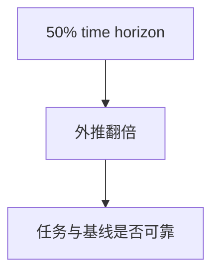

## Q
**时间跨度指标**｜怎么读 · 追问

METR 的「50% time horizon」说模型能独立完成的任务越来越长。这个指标是什么意思，外推时有哪些陷阱？

## A
**定义（METR，2025-03）：** 50% time horizon = 人类专家完成这类任务需要的时长，在这个时长上模型有 50% 的成功率。做法：把成功率对任务时长拟合逻辑曲线，读出 50% 的位置。

**结果：** 原论文：过去 6 年 time horizon 约每 7 个月翻倍；任务短于约 4 分钟时模型几乎 100% 成功，长于约 4 小时则不到 10%。

**陷阱：**

| 陷阱 | 说明 |
|---|---|
| 指数还是 S 曲线 | 早期的指数很难与 S 曲线区分，天花板在拐点后才可见 |
| 50% 不是可靠 | 50% 成功率的任务离生产可用还很远 |
| 任务是什么 | 任务套件以软件与推理任务为主，不代表所有工作 |
| 人类基线 | 时长取决于测的是哪些人；METR 自己说 SWE-bench 的翻倍更快部分是因为人类时间的测法不同 |

**核对日期：** 2026-11-21；METR 自己标注该页部分过时。

出处

METR, Measuring AI ability to complete long tasks（metr.org/blog/2025-03-19-measuring-ai-ability-to-complete-long-tasks）。

