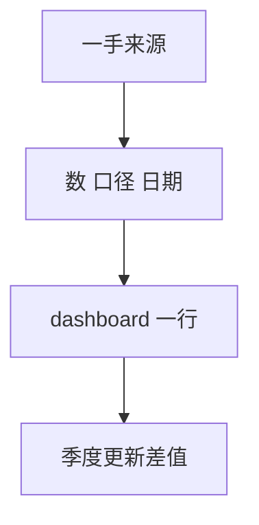

## Q
**自己的行业 dashboard**｜怎么读 · 追问

要建一个每季度更新的 AI 行业 dashboard，选哪十个指标？每个指标去哪取一手数据？

## A
| # | 指标 | 一手来源 |
|---|---|---|
| 1 | Hyperscaler capex 指引与 backlog | 各家 10-Q 与财报新闻稿 |
| 2 | NVIDIA data center 收入与毛利率 | NVIDIA 财报新闻稿、10-K |
| 3 | HBM 供应与价格 | TrendForce 等调研机构公开摘要 |
| 4 | GPU 租价 | 第三方租价追踪（要记录口径） |
| 5 | 同等能力的 token 单价 | AI Index、Epoch 的成本曲线 |
| 6 | 年化收入（lab 与应用） | 公司披露；State of AI 汇总（标明来源级别） |
| 7 | 电力并网与项目进度 | 项目公告、电网运营商公开队列 |
| 8 | 前沿基准与 time horizon | Epoch AI、METR |
| 9 | 开放与闭源差距 | AI Index 等 |
| 10 | 招聘与就业 | ADP 类行政数据、Anthropic Economic Index |

**规则：** 每个格子记**数、口径、日期、来源链接**；每季度只更新一次，标出上次与本次之差。

出处

本卡是方法设计；各来源见前面各卡。

