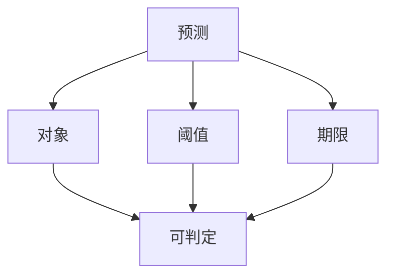

## Q
**怎么给预测打分**｜考点 · 追问

一位分析师预测「明年 AI 实验室的收入会翻倍」，另一位预测「数据中心会遇到阻力」。哪一个更容易检验，怎么把第二个写成可检验的句子？

## A
**可检验的预测有三要素：** 对象、阈值、期限。

| 预测 | 是否可检验 | 改写 |
|---|---|---|
| 收入会翻倍 | 要定义「收入」「哪几家」 | 「某年 12 月，A 与 B 两家披露的年化收入合计 ≥ 上年同期 2 倍」 |
| 数据中心会遇到阻力 | 太模糊，永远可以说中 | 「某年内，至少 N 个已公布的项目因本地反对被推迟或取消，由第三方统计」 |

**记分规则：** 事先写好判定标准；分三档（命中、部分、落空）；统计所有预测，不只是记得住的。

**对读者的用法：** 看到预测，先问「谁在预测、依据是什么、历史命中率是多少」。

出处

State of AI Report 2026（预测记分做法）；通用预测评估方法。

