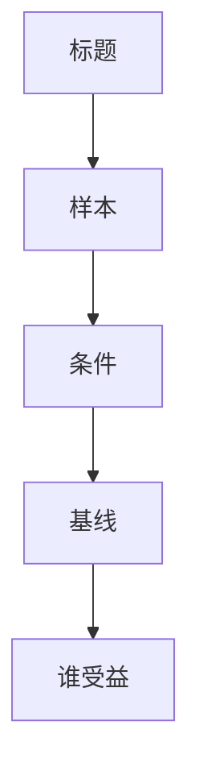

## Q
**拆解恐慌或狂热新闻**｜怎么读 · 必会

一条新闻说「AI 将在一年内取代 X%的工作」或「AI 泡沫即将破裂」。按什么顺序拆它？

## A
**四问：样本、条件、基线、谁受益。**

| 问 | 内容 | 例 |
|---|---|---|
| 样本 | 数据从哪来，多大，谁被排除 | 一家公司的用户、一份问卷 |
| 条件 | 结论成立的前提 | 「在高暴露职业的 22–25 岁人群中」，而非「所有人」 |
| 基线 | 与什么比 | 对照组、上一年、预测值 |
| 谁受益 | 发布者想让你怎么做 | 卖产品、募资、吸引流量、做空 |

**一个拆例：** Canaries 研究的标题式表述「年轻人被 AI 抢了工作」；原文说的是特定年龄、特定职业的就业比对照组低 19%，作者称是早期描述性指标、非因果，也没发现普遍性岗位流失。

**练习：** 把标题改写成一句带条件的话；改写后还成立吗？

出处

Canaries in the Coal Mine?（Stanford Digital Economy Lab，2026-08）；通用信息核对方法。

