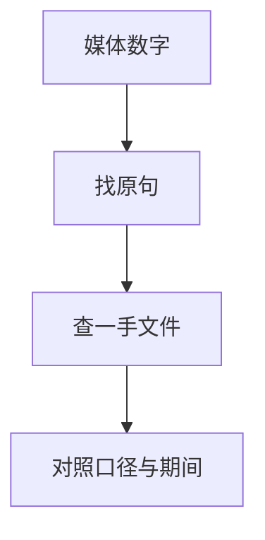

## Q
**Primary 与 secondary**｜怎么读 · 必会

同一个数字在三个地方出现：公司的 10-K、一篇财经媒体、一个投资博客。哪个是 primary，为什么要追到它？

## A
| 级别 | 例 | 特点 |
|---|---|---|
| **Primary（一手）** | 10-K / 10-Q、公司新闻稿、法院文件、政府公告、数据库原始表 | 能直接核对，有日期与文号 |
| **Secondary（二手）** | 媒体报道、分析博客、摘要网站 | 可能转述错、剪掉口径 |
| 三手 | 转发与聚合 | 常常丢掉出处 |

**追到源头的做法：**
1. 找到数字的句子，记下它声称的口径和日期；
2. 搜公司名加 10-K 或新闻稿，找原文；
3. 对照：数字、口径、期间是否一致；不一致的地方就是转述造成的。

**一个例子：** NVIDIA 2026 财年「客户集中度」：一个直接客户 22%、另一个 14%，在 10-K 里（经转载页核对）；二手分析写两个直接客户合计 36%，等于 22% + 14%，可由一手核对；但 10-K 还说有些间接客户各占收入 10% 以上而未披露比例，这层口径在摘要里容易丢。

**出处：** NVIDIA FY2026 10-K customer concentration（MarketScreener 转载页）；通用信息核对方法。
