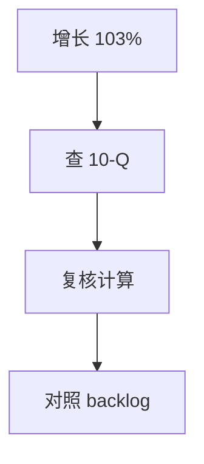

## Q
**把一句话追到源头**｜考点 · 追问

读到「某云的 AI 业务收入增长 103%」。你会按什么顺序追，最后应该能回答哪三个问题？

## A
**例子：** Alphabet 2026 年第三季度 Google Cloud 收入 307.1 亿美元，上年同期 151.6 亿美元（+103%，9to5Google 引 CEO 原话）。

**追的顺序：**
1. 找 Alphabet 的季度新闻稿和 10-Q（一手），确认 Cloud 分部的收入；
2. 看口径：这里是整个 Cloud 分部（含 AI 与传统云），不只是 AI；
3. 算增速：307.1 ÷ 151.6 ≈ 2.03 → +103% 可复核；
4. 找同期的 backlog 与 capex，判断增长背后的投入。

**最后要能答：**

| 问题 | 答案来自 |
|---|---|
| 数字是不是真的 | 一手文件 |
| 它量的是什么 | 分部口径 |
| 它是领先还是滞后指标 | 与 backlog、capex 对照 |

**核对日期：** 2026-11-21。

出处

9to5Google, Alphabet Q3 2026 earnings（2026-10-28）；一手文件请读 Alphabet 10-Q。

