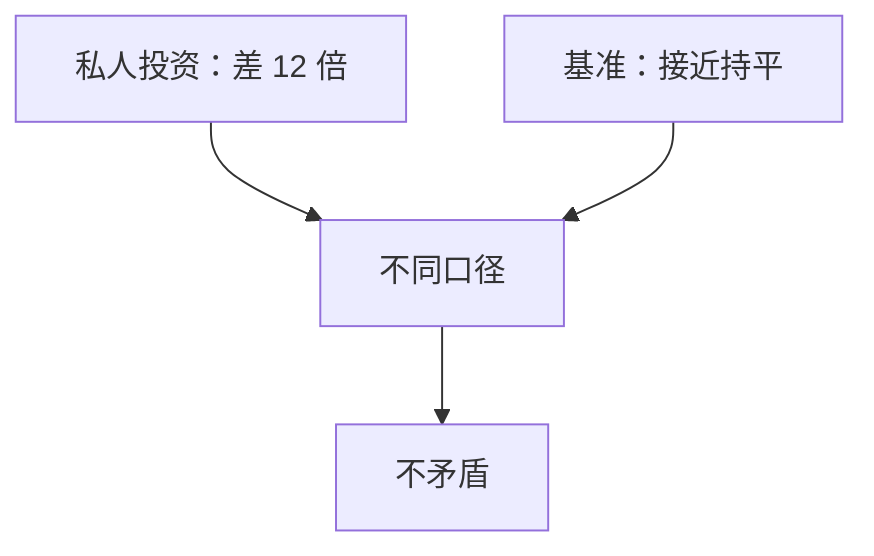

## Q
**同一件事，三份报告**｜考点 · 追问

AI Index 说 2024 年美国私人 AI 投资 1091 亿美元，是中国的近 12 倍；一份投资机构报告说中国正在迅速追赶。两者矛盾吗？

## A
**不一定矛盾，因为量的是不同的东西：**

| | AI Index | 投资机构的「追赶」 |
|---|---|---|
| 量的什么 | 私人投资额（美国 1091 亿 vs 中国 93 亿美元，2024） | 往往是能力、模型数量、成本 |
| 口径 | 仅私人资本；政府出资不在其中，所以不能直接当作「总投入」 | 取决于作者选的指标 |
| 时间 | 2024 年 | 可能是更新的数据 |

**结论：** 投入口径和产出口径不同：私人资本的差距很大；模型能力的差距则在部分基准上接近持平（AI Index 2025）。

**读法：** 对比两份报告，先把各自量的**对象、口径、时间**写成一行，再判断是否矛盾。

**核对日期：** 2026-11-21。

**出处：** Stanford HAI, AI Index Report 2025（私人投资与基准）。
