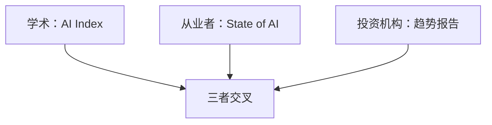

## Q
**三类趋势报告的立场**｜摘要 · 必会

AI Index、State of AI 和投资机构的 AI 趋势报告（如 Meeker 的 BOND 报告）都是「行业大报告」。它们各自的立场是什么，盲区在哪里？

## A
| 报告 | 谁做的 | 视角 | 偏向 | 盲区 |
|---|---|---|---|---|
| **AI Index** | Stanford HAI（高校研究所） | 学术、数据驱动，多章节：研发、技术性能、经济、政策等 | 偏重可量化、已发表的数据；滞后约一年（2025 版讲 2024 年） | 最新的商业动态与传闻 |
| **State of AI** | Nathan Benaich 与 Air Street Capital（风险投资机构），第 9 版，244 页 | 从业者与投资人 | 偏向创业与前沿动态，会给预测并自评 | 作者有投资立场 |
| **投资机构趋势报告**（如 BOND） | 风险投资 / 咨询机构 | 市场与增长故事 | 倾向于展示增长和机会 | 对风险与失败案例着墨较少 |

**用法：** 同一个问题，学术报告给基线，从业者报告给最新动向，投资机构报告给市场叙事；三者一致的结论更可信。

**出处：** Stanford HAI, AI Index Report 2025；State of AI Report 2026（stateof.ai）；BOND 一类报告的归类为通用判断，本卡未逐页核对其数字。
