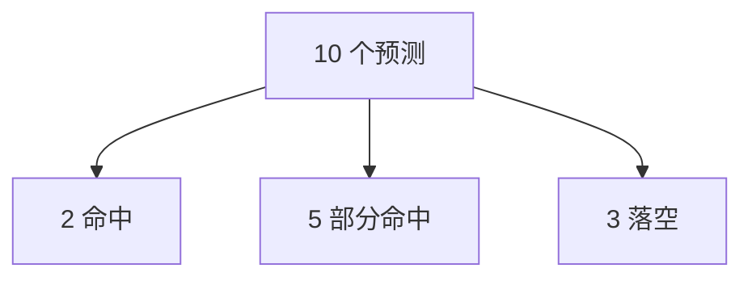

## Q
**预测的记分**｜摘要 · 必会

State of AI 每年发布下一年的预测，并在次年自评。它的上一年成绩是怎样的，为什么要看这个？

## A
**成绩（State of AI Report 2026 自评上年预测）：** 命中 2 个，部分命中 5 个，落空 3 个（共 10 个）。

| 结果 | 例 |
|---|---|
| 命中 | AI 实验室为了赢得美国政府的好感，重新回到开源；一家中国实验室在重要的任务榜单上登顶 |
| 部分命中 | 数据中心反对：反弹确实发生，但对 11 月选举的影响还没有结论 |
| 其余 | 页面没有逐条列出 |

**为什么要看：** 作者是在记自己的分。完全命中率约两成，说明即使是行业内的专业预测者，**方向对的概率也有限**。用它来校准你对任何预测的信任：多数预测会部分对、部分错。

**注意：** 自评有主观成分；命中标准由作者定义。

**核对日期：** 2026-11-21。

**出处：** State of AI Report 2026（stateof.ai）。
