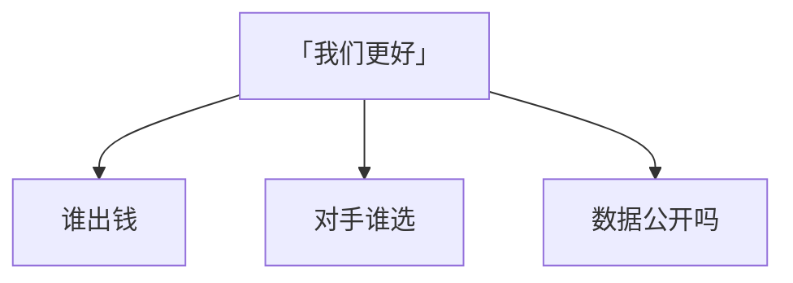

## Q
**厂商博客与论文的利益**｜怎么读 · 追问

一篇「我们的模型比对手好」的厂商技术报告，与一篇独立论文，可信度怎么分？

## A
| 来源 | 常见偏向 | 怎么补偿 |
|---|---|---|
| 厂商博客与技术报告 | 只报有利结果；自选基准与设置；对手版本旧 | 找第三方复测、看被省略的基准 |
| 学术论文（含预印本） | 发表偏倚；预印本未评审 | 看是否复现、数据与代码是否公开 |
| 评测机构 | 受托评测可能有资助关系 | 看披露、方法是否公开 |
| 研究者自己的实验 | 样本小 | 重复一遍 |

**一个例证：** State of AI 2026 提到，同一个模型换工具、上下文和反馈后，在 SWE-bench Verified 的 100 道任务上成功率从 52.5% 到 65.5%——厂商对「我们的模型能做到 X」的声明，要看用了什么脚手架。

**核对三句：** 谁出的钱？谁选的对手？原始数据与设置在哪？

**出处：** State of AI Report 2026（stateof.ai）；通用研究方法。
