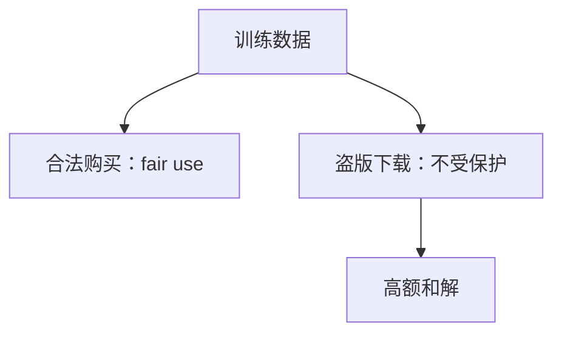

## Q
**版权诉讼与数据成本**｜摘要 · 追问

AI 公司用书训练模型算不算侵权？Bartz v. Anthropic 的结果对数据成本意味着什么？

## A
**案件：** Bartz v. Anthropic（美国加州北区联邦法院）。

| 时间 | 事件 |
|---|---|
| 2025-06 | Alsup 法官裁定：用合法购买的书训练模型属于 fair use（合理使用）；从盗版影子图书馆下载大量书籍不属于 |
| 2025-09 | 初步批准和解 |
| 2026-07-20 | Martínez-Olguín 法官最终批准 15 亿美元和解，约 50 万部作品，每本约 3000 美元；作者与出版社通常各分一半 |

**含义：**
- **数据来源比训练行为更关键**：合法获取的数据可能受保护，盗版来源不受保护；
- 和解**不产生约束性先例**；
- 对成本：数据变成有明确价码的成本项，licensing deal（付费获得数据授权）更有吸引力。

**核对日期：** 2026-11-21；其他案件结果各不相同。不是法律意见。

**出处：** The Next Web, Anthropic $1.5B copyright settlement approved（2026-07-21）。
