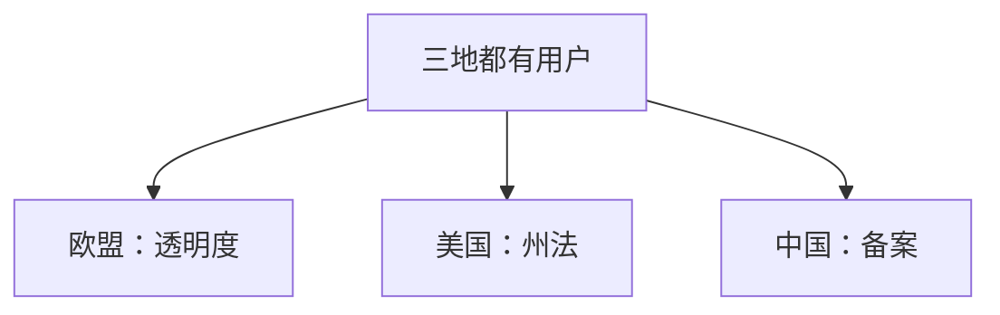

## Q
**监管对公司意味着什么**｜考点 · 追问

你的公司在欧盟、美国、中国都提供一个聊天机器人。三个地区各要你做什么，哪一项最先要到位？

## A
| 地区 | 你要做的 | 触发条件 |
|---|---|---|
| 欧盟 | 让用户知道在和 AI 交互（透明度）；如果你训练或提供通用模型，要有技术文档与训练内容摘要 | AI Act 的有限风险与 GPAI 条款 |
| 美国 | 遵守你所在州的法律；联邦行政令本身不取消州法，要关注任务组的诉讼与国会动向 | 业务所在州 |
| 中国 | 面向公众的服务要符合暂行办法，涉及舆论属性的服务要做安全评估和算法备案 | 在中国境内向公众提供服务 |

**优先级判断：** 先看**你在每个地区的实际业务**（有没有用户、有没有数据），再按已生效的条款排期。AI Act 的 2025-08-02 GPAI 义务和 2026-08-02 的透明度条款（Article 50）已经到期；高风险义务晚到 2027-12。

**出处：** AI Act 高层摘要（artificialintelligenceact.eu）；DLA Piper 对美国行政令与中国暂行办法的分析。本卡不是法律意见。
