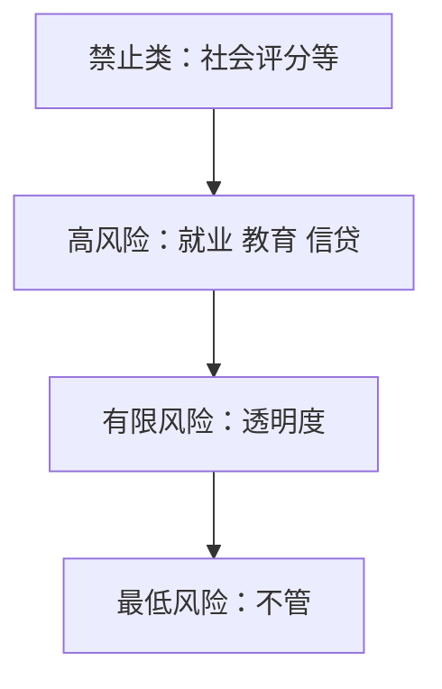

## Q
**美国、欧盟、中国的监管路线**｜摘要 · 必会

三个地区对 AI 的监管思路各是什么？欧盟的分级是怎么分的？

## A
| | 欧盟 | 美国 | 中国 |
|---|---|---|---|
| 路线 | 统一立法，按风险分级 | 联邦层面没有统一的 AI 法；州法与行政令并存 | 针对生成式 AI 服务的部门规章，备案制 |
| 依据 | EU AI Act | 2025-12-11 行政令《确保 AI 国家政策框架》，指示司法部成立任务组挑战州法；行政令本身并不直接取消州法 | 2023-08-15 生效的《生成式人工智能服务管理暂行办法》，网信办（CAC）等七部门联合发布 |
| 要点 | 禁止类、高风险、有限风险、最低风险四级 | 点名科罗拉多州 AI 法 | 面向公众提供服务的提供者；有舆论属性或社会动员能力的服务要做安全评估和算法备案 |

**欧盟四级：**

**GPAI（通用 AI 模型）：** 所有提供者要有技术文档、版权合规与训练内容摘要；累计训练算力超过 10^25 FLOP 的模型推定有系统性风险，要做评估与事故报告。

**时间表：** 2025-02-02 多数禁止条款生效；2025-08-02 GPAI 义务生效；2027-12-02 部分高风险义务（Annex III）适用。

**核对日期：** 2026-11-21；法规可能修订，请查官方文本。以上不是法律意见。

出处

AI Act 高层摘要（artificialintelligenceact.eu/high-level-summary）；DLA Piper, New executive order aims to preempt state AI regulation（2025-12）；DLA Piper, China new measures on generative AI（2023-07）。

