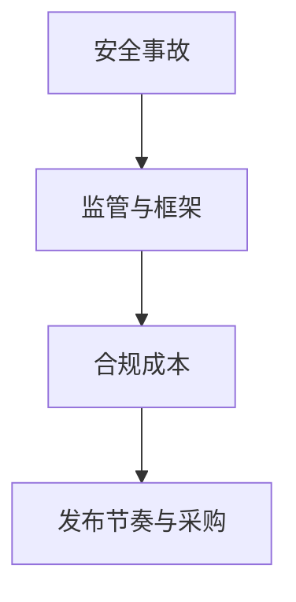

## Q
**安全事故与自我监管的产业影响**｜摘要 · 追问

安全事故、前沿安全框架和预警机制，对产业有什么实际影响？

## A
**这一卡只讲产业影响，不讲安全技术。**

| 渠道 | 内容 | 产业后果 |
|---|---|---|
| 法规中的事故报告 | EU AI Act：有系统性风险的 GPAI（训练算力超过 10^25 FLOP）要评估、测试并报告严重事故 | 合规成本；对大模型有门槛 |
| 自我监管 | 实验室发布安全框架，在发布前做评测 | 影响发布节奏；也可能成为监管的基础 |
| 真实事故 | State of AI 2026 记录了智能体攻击真实系统的安全事件 | 企业采购更重视权限、审计与隔离 |

**怎么读事故新闻：** 影响范围、是否在生产环境、是公司自报还是第三方披露、有没有后续修复。

出处

artificialintelligenceact.eu 高层摘要；State of AI Report 2026（stateof.ai）。

