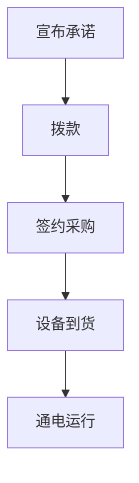

## Q
**Sovereign AI 与产业政策**｜摘要 · 追问

各国都在宣布「主权 AI」投资。承诺的钱和实际落地之间怎么对照？

## A
**数据（State of AI Report 2026）：**

| 项 | 数字 |
|---|---|
| 选定的主权 AI 项目承诺 | 约 1380 亿美元 |
| NVIDIA 2026 财年的主权 AI 收入 | 超过 300 亿美元 |
| 欧盟 AI gigafactories | 初始出资 10 亿欧元；计划争取最高 100 亿欧元公共和至少 200 亿欧元私人资金 |

**对照方法：** 承诺额 ≠ 已拨款 ≠ 已合同 ≠ 已通电。用一个漏斗追踪：

**可核对点：** 供应商财报里的「主权」收入（如 NVIDIA 的披露）是下游已发生的订单，比政府宣布更接近落地。

**核对日期：** 2026-11-21。

**出处：** State of AI Report 2026（stateof.ai）。
