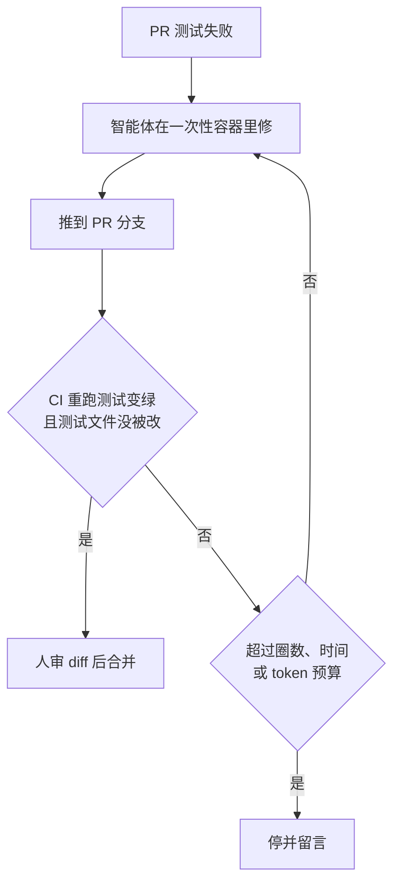

## Q
**挑战。** 团队想做一个无人值守的 CI 机器人：PR 的测试失败时，自动启动一个编程智能体修复，并把改动推回 PR 分支。现场没有人点"允许"。请设计它的 harness：权限怎么设、在哪里运行、怎么判断修好了、什么时候停。

## A
**评分点（答出 3 条算过）：**

1. 权限必须预先写成规则，而不是靠弹窗：只放行读写仓库文件、跑指定的测试命令；删除、联网、改 CI 配置、读密钥一律拒绝。
2. 运行环境隔离：一次性容器或沙箱，不带生产密钥，网络限制在白名单，只给能推送到该 PR 分支的最小令牌。
3. 验证由外部完成：以 CI 重新跑测试的结果为准，而不是智能体自己说"修好了"；还要防它改测试或特判让测试变绿（比如检查测试文件有没有被改）。
4. 设停止条件：最大圈数、最长时间、token 预算，超了就停并留言，不无限重试。
5. 保留人的关口：只推到 PR 分支，不直接合并，由人审 diff；任务内容里的 PR 描述和评论是不可信输入，要防提示注入。

参考答案
无人值守意味着不能靠权限弹窗，所以把允许和拒绝的动作写成规则，运行在一次性容器里，令牌只能推该分支，不放生产密钥，网络只开白名单。判断修好以 CI 重新跑的测试为准，并检查智能体有没有改测试文件或特判。同时设最大圈数、时间和 token 预算，超限就停并留言。结果只推到 PR 分支，由人审 diff 后合并，而且要把 PR 评论当作不可信输入来对待。

