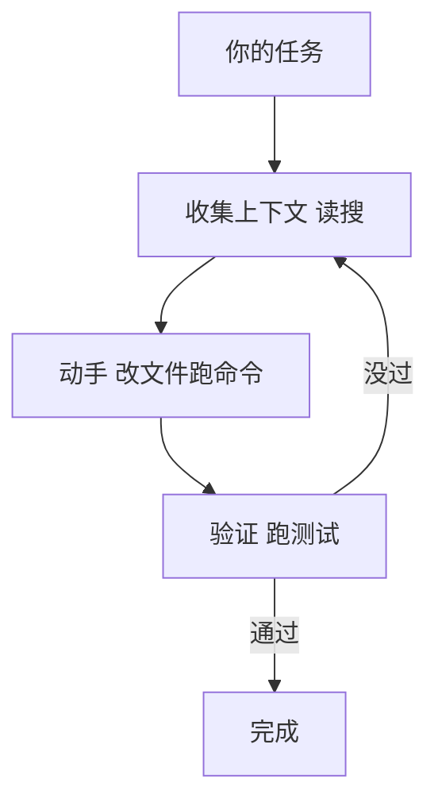

## Q
Claude Code 这类编程智能体到底在做什么？模型和 harness 各负责什么？

## A
**编程智能体 = 一个"读文件、改文件、跑命令"的智能体循环，外面包一层 harness（给模型提供工具、管理上下文、拦住危险动作的程序）。**

**模型负责：** 读懂代码、决定下一步、写出改动。**harness 负责：**
- **工具：** 文件读写、搜索（按文件名或正则）、执行命令（跑测试、用 git）、联网查文档。
- **权限：** 动作执行前问你，或按规则放行、拒绝。
- **上下文管理：** 窗口快满时把历史压缩成摘要；把子任务交给独立窗口的子智能体。
- **记忆文件：** 每次会话开头自动读入 `CLAUDE.md`（项目约定）。
- **检查点：** 改文件前先快照，按两次 Esc 可以回退。

你在屏幕上看到的每个提示、每次"正在读取 xx 文件"，都是这个循环的一圈。例：说"修好失败的测试"，它会自己跑测试、读报错、搜文件、改代码、再跑一遍。

**入口不同，结构相同：** Claude Code 跑在终端和 IDE 里；Cursor 以编辑器为中心；Codex 有命令行，也能在云端沙箱里排队跑任务。区别主要在 harness 的设计和模型，而不是"另一种技术"。
