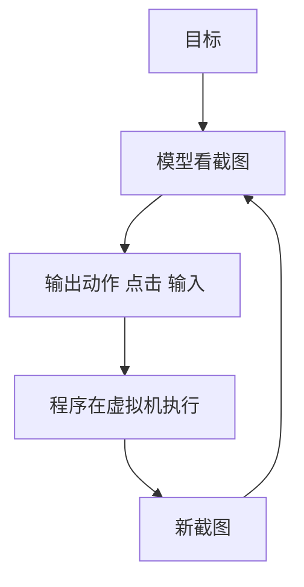

## Q
计算机使用（computer use）是怎么让模型"操作电脑"的？

## A
**把"看屏幕、动鼠标键盘"做成工具：模型看截图，输出"在 (x, y) 点击""输入这段字"，你的程序在虚拟机里真的执行，再把新截图交回去，一圈一步。**



模型一次返回的动作（示意）：

```json
{"action": "left_click", "coordinate": [640, 360]}
```

- **模型只给出坐标，不执行。** 执行的是你的程序，所以你可以把它关在虚拟机或容器里。
- **动作集很小：** 截图、移动或点击、拖拽、输入文字、按键、滚动、放大看某块区域、等待。
- **坐标是截图的像素坐标，** 原点在左上角。截图若被缩小以适应模型的图片上限，要把坐标按比例还原再点击；Mac 的 Retina 屏幕还要考虑 2 倍像素比。
- **一次可以返回多个动作，** 程序顺序执行，遇到第一个失败就停下并把错误返回。
- **浏览器智能体就是同一套做法，** 把"屏幕"换成"浏览器页面"。

**为什么需要它：** 很多软件没有接口：老式内部系统、只能靠网页表单的流程。只要人能点得到，它就有机会点到。

**官方建议的运行方式：** 专用虚拟机，不放敏感凭据，网络只开白名单域名，购买和同意条款这类有后果的动作要人确认。
