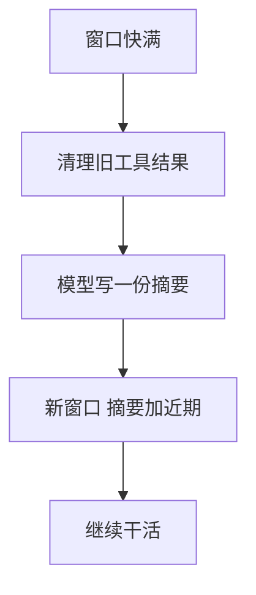

## Q
智能体的上下文窗口快满时会发生什么？"压缩"和"清理旧工具结果"各做什么？

## A
**窗口是有限资源，越满模型越容易漏掉细节（上下文腐化，context rot）；压缩就是把长历史换成一份摘要，在新窗口里接着干。**

**三个手段，由轻到重：**
1. **清理旧工具结果：** 一次读了 3,000 行的命令输出，模型看完就用不上了，删掉原文，只留"已经读过"。最便宜，不丢对话主线。
2. **压缩（compaction）：** 让模型把到目前为止的历史写成摘要：保留用户的请求、关键代码片段和已做的决定，丢掉细节。Claude Code 接近上限时自动做，也可以手动 `/compact` 并指定重点，比如"保留 API 改动"。
3. **写到外部：** 把长期信息存进文件，需要时再读，比如项目约定写进记忆文件。

**代价：** 摘要是有损的。写摘要的是模型，它判断哪些重要；后面才发现需要的细节，可能已经被丢掉。

**新进展（2025 年 9 月）。** Anthropic 在开发者平台发布上下文编辑（自动清掉旧的工具调用和结果）和记忆工具（文件式、存在客户端）。在他们的内部评测里，两者合用比基线好 39%，只用上下文编辑好 29%。

想一想：为什么"清理旧工具结果"比"总结整段对话"更不容易出错？
清理只删已经被模型消化过的原始输出，对话主线，也就是目标和已做的决定，原样保留；总结要靠模型判断什么重要，可能把后面要用的细节丢掉。

