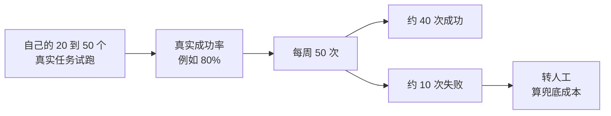

## Q
**挑战。** 一家供应商在发布会上说："我们的智能体 50% 时间跨度是 10 小时，可以替代一个工程师半天的工作。"你们有个任务，人类工程师要 4 小时，每周要跑 50 次。采购问你能不能直接上。请用时间跨度的定义，说出你会追问什么、会怎么估计这 50 次的结果、怎么部署。

## A
**评分点（答出 3 条算过）：**

1. 解释 50% 的含义：跨度 10 小时是指人类要 10 小时的这类任务大约一半能成，不是"能可靠地干 10 小时"；4 小时的任务虽然低于跨度，成功率也不是 100%。
2. 追问测量条件：任务类型是否像你们的、是否可自动判分、置信区间多宽、是不是自己人测的、有没有排除作弊。
3. 追问 80% 跨度：可靠完成的时长比 50% 的更短，你们的任务应该对照这个数。
4. 给出估计方法：用自己的 20 到 50 个真实任务试跑几次，量真实成功率；若成功率是 80%，每周 50 次就有约 10 次失败，要算人工兜底的成本。
5. 部署设计：每步可验证的检查点、失败时自动转人工、不可逆动作先确认，而不是一次性全交给它。

参考答案
50% 跨度 10 小时只说明人类要 10 小时的同类任务大约一半能成，4 小时的任务成功率也未必高到可以放手，要看 80% 跨度和测量条件：任务类型像不像你们的、有没有自动判分、区间多宽、有没有排除作弊。最可靠的办法是拿自己的真实任务多次试跑，得到真实成功率；比如 80% 就意味着每周 50 次约有 10 次要人处理。上线时每步设可检查的验证，失败转人工，不可逆动作需要确认。

