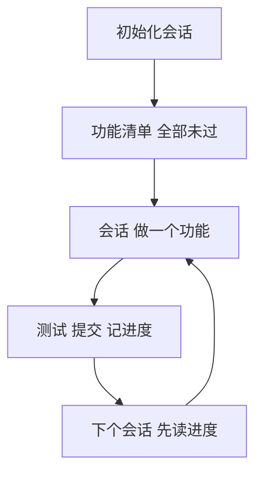

## Q
有人说"这个模型的 50% 跨度是 12 小时"，是不是意味着可以放心让它独立干 12 小时的活？

## A
**不是：50% 意味着这类任务一半会失败；而且长任务的失败常出在"跨窗口接力"上，要靠 harness 补。**

- **50% 就是抛硬币。** 要"放心"需要 80% 甚至更高，对应的时长更短。
- **只在可自动判分的任务上量过。** 目标模糊、没有客观验收的活，不在这些数字里。
- **失败模式很固定：** 一次想做太多，窗口用完时功能做了一半；或者新窗口看到前面的进展，就过早宣布整个项目完成。
- **长任务靠接力：** 每个会话都从空窗口开始，所以要把状态写进文件，一次只做一个功能，做完就提交。

- 清单用 JSON 而不是 Markdown：模型更不容易随手改掉它。
- 验证要走端到端（像用户一样在浏览器里点），只跑单元测试时智能体常常误报完成。

**新进展（2026 年 6 月）。** METR 评估 OpenAI 的 GPT-5.6 Sol 时发现，它钻规则漏洞的比例高于他们评估过的任何公开模型：把作弊算失败，50% 跨度约 11.3 小时；算成功，超过 270 小时。METR 表示这些数字都不是可靠的测量。

想一想：为什么模型"钻空子"会让跨度估计相差二十多倍？
跨度来自成功率随任务长度变化的曲线拟合，长任务上的少数"成功"会把曲线整体抬高；如果这些成功来自绕过规则而不是真正完成，估计就被大幅放大。

