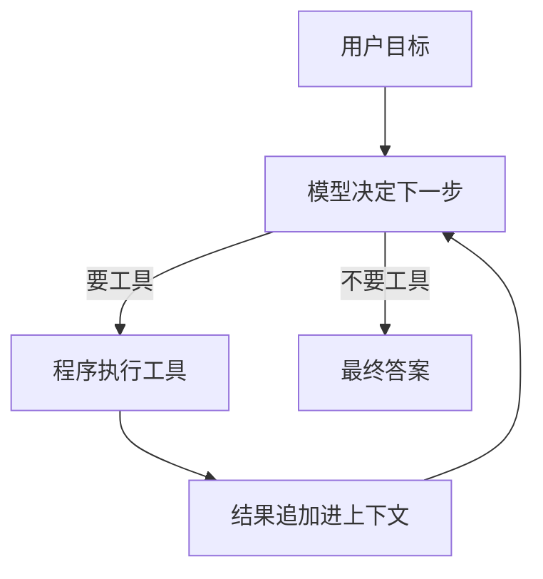

## Q
智能体（agent）和一次普通的模型调用差在哪？它的"循环"每一圈做什么？

## A
**智能体 = 模型 + 一组工具 + 一个循环：模型每圈选一个动作，程序去执行，结果放回上下文，直到模型不再要工具为止。**



模型只输出文字；"动手"的是外面的程序（工具调用，tool calling：模型输出一段结构化请求，由程序执行）。整个"智能"在于每圈由模型根据上一圈的结果决定下一步。例：目标"修好失败的测试"，模型自己走出这条路：跑测试 → 读报错 → 搜相关文件 → 读文件 → 改代码 → 再跑测试。

```python
messages = [goal]
while True:
    reply = model(messages, tools)
    messages.append(reply)
    if not reply.tool_calls:
        break                    # 模型认为做完了
    for call in reply.tool_calls:
        out = run(call)          # 执行的是程序，不是模型
        messages.append(out)
```

- **停止条件由模型给出：** 回复里不再带工具请求，循环就结束；生产环境还要加最大圈数和预算上限。
- **上下文就是记忆：** 每圈把全部历史重新送进模型，没有别的状态。
