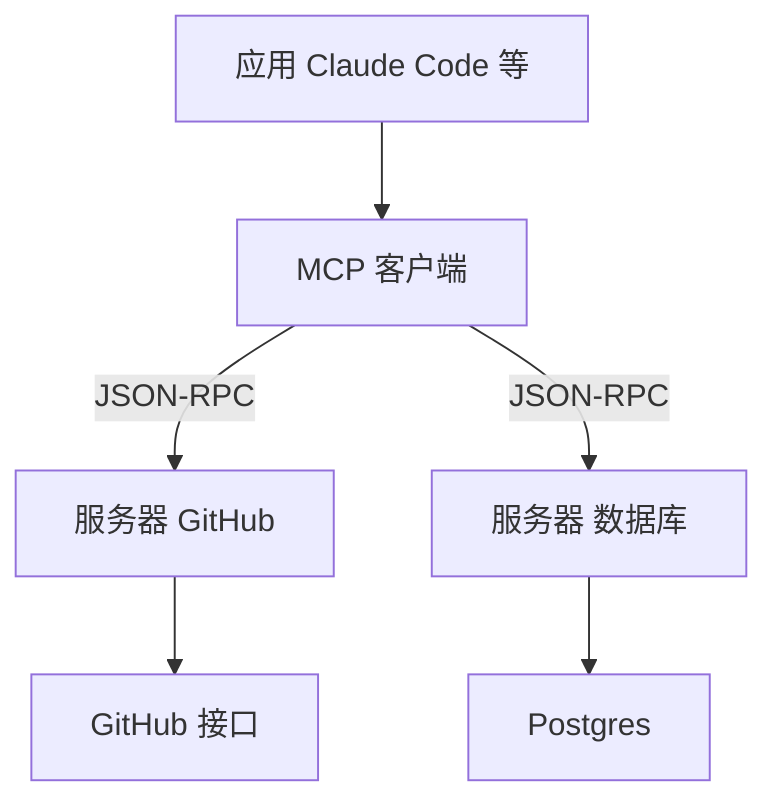

## Q
模型上下文协议（MCP，Model Context Protocol）是什么？它解决什么问题？

## A
**MCP 是一个开放协议：工具和数据的提供方写一次"MCP 服务器"，任何支持 MCP 的应用（客户端）都能直接用，把 N 个应用 × M 个工具的接线变成 N + M。**



**服务器能提供三种东西：**
- **工具（tools）：** 模型可调用的动作，如"创建 issue"。
- **资源（resources）：** 可读取的数据，如文件、数据库表。
- **提示模板（prompts）：** 预置好的提示，用户可一键选用。

**怎么连：** 本机用标准输入输出（stdio，客户端启动一个子进程）；远程用 HTTP，授权走 OAuth。消息格式是 JSON-RPC。客户端启动时问服务器"你有哪些工具"，把答案放进模型的工具列表，之后就是普通的工具调用循环。服务器返回的工具描述长这样：

```json
{"name": "create_issue",
 "description": "Open an issue in a repo",
 "inputSchema": {"type": "object",
   "properties": {"repo": {"type": "string"},
                  "title": {"type": "string"}}}}
```

例：在 Claude Code 里用 `claude mcp add` 接入 GitHub 服务器，模型的工具列表里就多出了这些 GitHub 动作；换成 Cursor，同一个服务器照样能用，不用重写。
