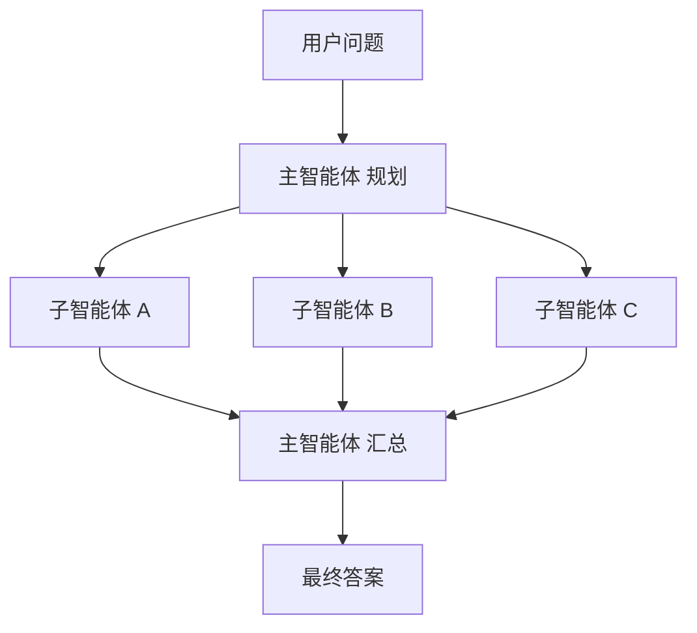

## Q
多智能体系统里，主智能体和子智能体怎么分工？为什么要拆？

## A
**一个主智能体（orchestrator）负责规划和汇总，把子任务分给多个子智能体（subagent）；每个子智能体有自己干净的上下文窗口，可以并行干活，只把摘要交回来。**

**例：** 问"对比五家云厂商的 AI 芯片布局"。主智能体先把计划写下来，然后派出几个子智能体，每个负责一两家厂商：各自搜索、读网页、筛选，最后只交回一页结论。主智能体合并后再判断要不要继续查。

**为什么要拆：**
- **并行：** 几个子智能体同时搜，墙钟时间大幅缩短。
- **隔离上下文：** 一个子智能体读几十个网页，这些原文都留在它自己的窗口里，主窗口只收到摘要，不会被塞满。
- **突破单窗口：** 要处理的信息总量超过一个窗口时，只能分开处理再合并。

**和固定流程里的"协调者-工人"模式的区别：** 那里的工人只做一次模型调用；这里每个子智能体自己就是一个完整的循环，能多次调用工具，主智能体拆几份、分给谁，都在运行时决定。
