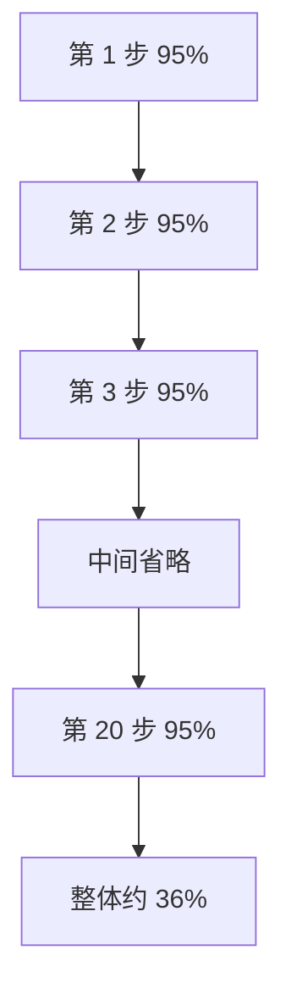

## Q
智能体为什么不稳？"每步 95%，连做 20 步"是什么意思？

## A
**多步任务的成功率是每一步成功率的连乘：每步 95%，连做 20 步，整体只剩约 36%。**

| 每步成功率 | 10 步 | 20 步 | 50 步 |
|---|---|---|---|
| 99% | 90% | 82% | 61% |
| 95% | 60% | 36% | 8% |
| 90% | 35% | 12% | 0.5% |

**这是简化的上界估计：** 假设各步独立，一步错就全盘失败。现实更复杂：
- **有的错能被纠正：** 测试失败了，模型看到报错重试；
- **有的错会传染：** 误读了一条返回，后面 10 步都建立在这个误读之上，窗口里的错误还会拉低后续判断。

**三个杠杆：**
1. **提高每步成功率：** 更强的模型、更清楚的工具描述（Anthropic 重写工具描述后，后续智能体完成任务的时间缩短了 40%）。
2. **减少步数：** 把几步合并成一个更粗的工具，或让模型写一段代码一次做完。
3. **加检查点和验证：** 每隔几步用代码检查结果，把"悄悄累积的错误"变成"当场发现、重试一次"。

所以智能体的可靠性设计，本质是把一条长链拆成带检查的短链。
