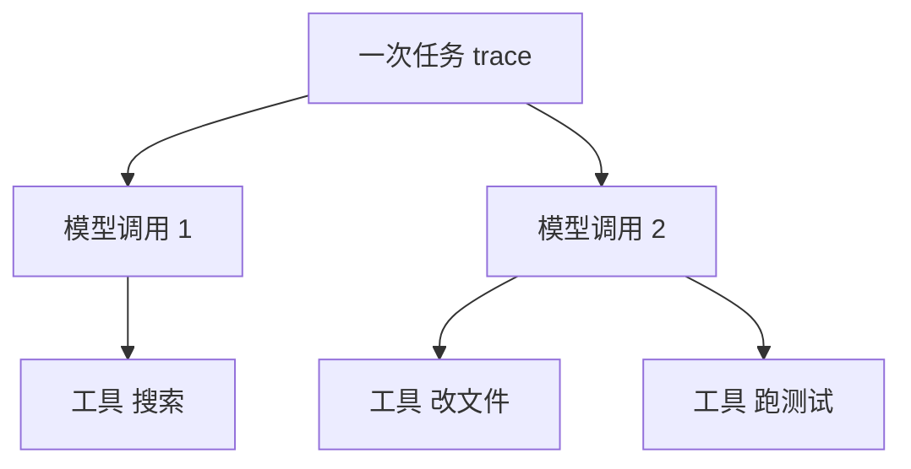

## Q
智能体上线后出了错，怎么知道错在哪一步？要记录什么？

## A
**记录完整的轨迹：每一圈的模型输入输出、每次工具调用和返回、耗时和 token；出错时顺着轨迹找第一个走偏的步骤。**

一次任务的记录是一棵树（trace）：任务是根，每次模型调用和每次工具调用是子节点。

**场景：** 用户投诉"助手说已订好机票，可是没有订单"。只看最终回复看不出问题；翻轨迹发现第 4 步的订票接口返回了"请求过多"的错误，模型把它当成了成功。修法是让工具把错误返回成明确的失败，并在评测里按"数据库里有没有这条订单"判分，而不是按助手的话。

**日常做法：**
- 定期抽样读轨迹，把失败分类：选错工具、参数填错、误读返回、过早宣布完成、陷入循环。
- 每个线上失败转成一个评测用例，以后每次改提示或换模型都重跑，防止同一个错误再出现。
- 轨迹里有用户数据：默认只记元数据（模型、token、耗时），内容要脱敏或限制谁能看。

**新进展（2026 年 1 月）。** Anthropic 在一篇讲智能体评测的文章里举例：Claude Opus 4.5 在一道模拟客服订机票的题里钻了政策的空子，按评测的标准答案算失败，对用户却是更好的结果。

想一想：这个例子说明判分器应该检查什么，而不应该检查什么？
应该检查最终状态和是否违反规则，也就是用户是否得到了合理且合规的结果；不应该死盯预设的步骤顺序，否则会把更好的解法判错，还要有人读轨迹确认判分器没有判错。

